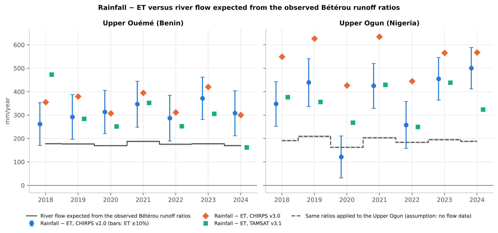
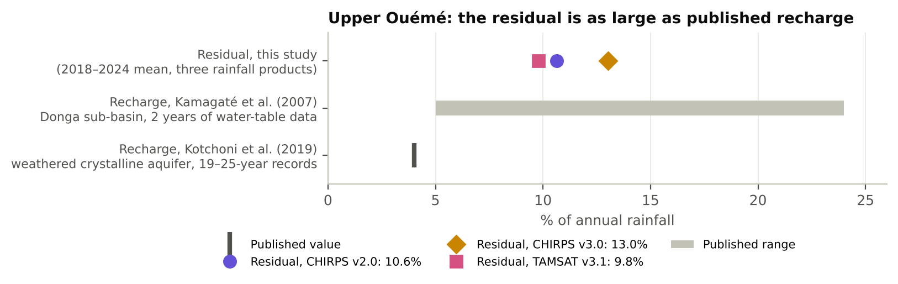
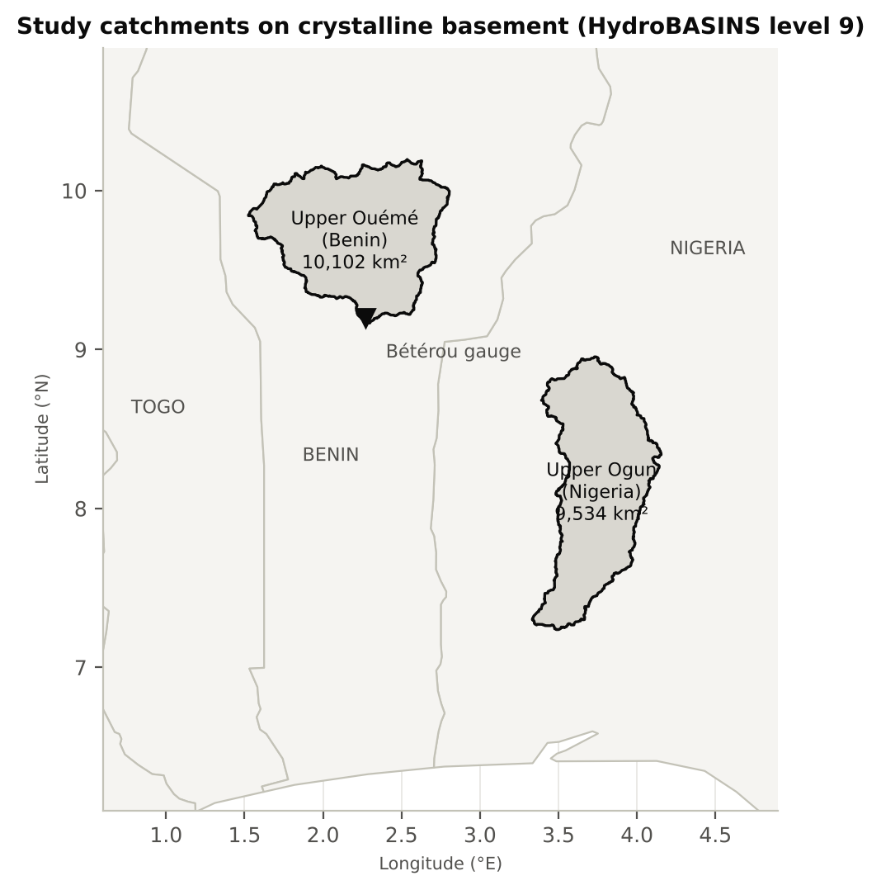
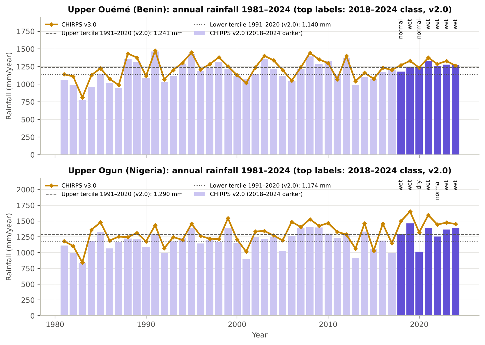
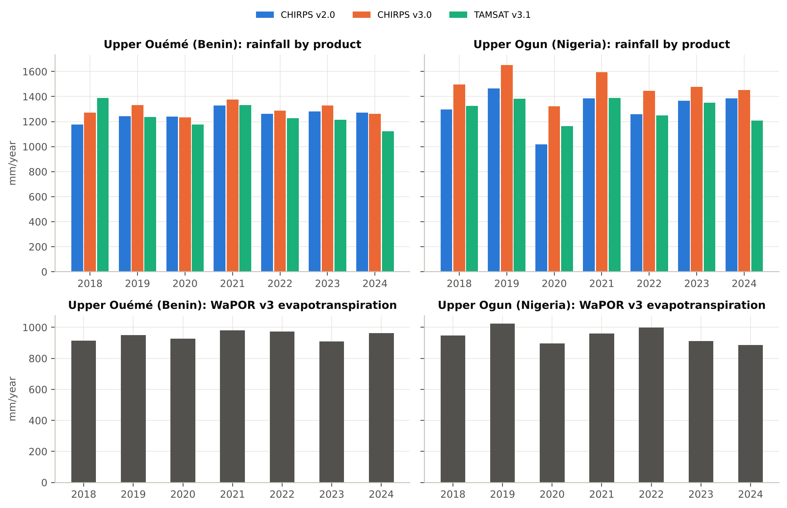
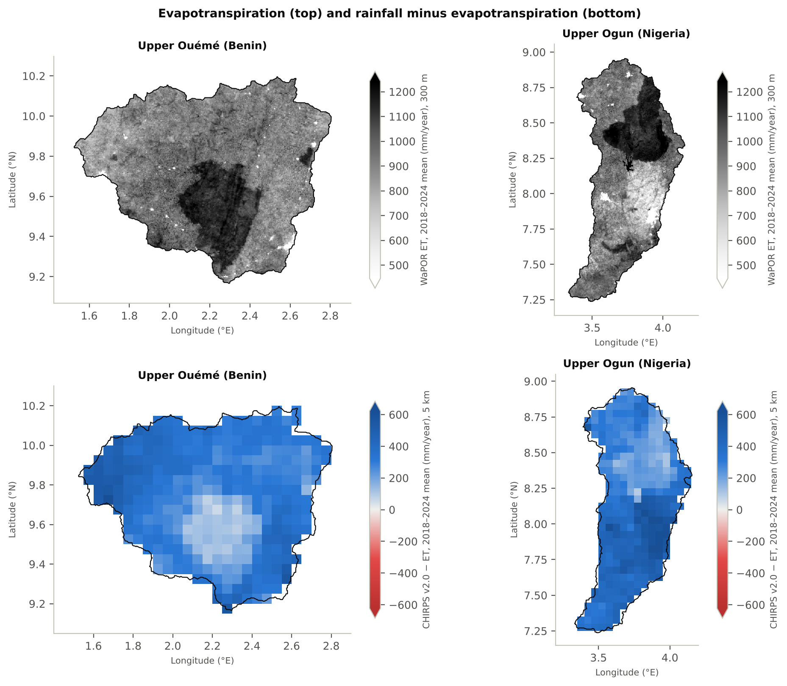

# A Satellite Water Balance for Groundwater Recharge in Tropical Basement Catchments

**Upper Ouémé (Benin) and Upper Ogun (Nigeria), 2018–2024**

Free satellite data now give annual rainfall (CHIRPS, TAMSAT) and actual evapotranspiration (FAO WaPOR) for any catchment, and "rainfall minus evapotranspiration" is often used as a first estimate of groundwater recharge where wells are not monitored. This project tests whether that works in the crystalline-basement catchments that supply rural wells in Benin and southwestern Nigeria. The Upper Ouémé, where river flow has been measured, is the test case. The Upper Ogun, where no flow data were found, is the application.

**Short answer: not with these products at this scale.** In the Upper Ouémé, rainfall − ET over 2018–2024 exceeds the river flow expected at Bétérou by **121–169 mm/year** (10–13% of rainfall), in every year and with every rainfall product. If that were water stored underground, the water table would have risen by **at least 56 m** over the seven years, so it is not stored water. It is error in the rainfall, ET or river-flow terms, and it is **as large as recharge itself**: groundwater-level studies in Benin's crystalline basement report recharge of about 4% of rainfall (Kotchoni et al., 2019) and 5–24% (Kamagaté et al., 2007). A satellite balance therefore cannot resolve recharge here without field data. This project measures the size of that gap and sets out the data needed to close it.



*Rainfall − ET for three rainfall products (points; bars on CHIRPS v2.0 show ET ±10%) against the river flow expected from the two observed Bétérou runoff ratios (line: their midpoint; gray band: their range, a few mm wide). For the Upper Ogun the line is dashed: no flow data exist there, so it only shows what the Bétérou ratios would give.*

## Key numbers (2018–2024 means)

| | Upper Ouémé at Bétérou (Benin) | Upper Ogun above the Oyan confluence (Nigeria) |
|---|---|---|
| Catchment area (this study) | 10,102 km² | 9,534 km² |
| Rainfall: CHIRPS v2.0 / CHIRPS v3.0 / TAMSAT v3.1 | 1,257 / 1,298 / 1,243 mm/yr | 1,311 / 1,492 / 1,296 mm/yr |
| Actual ET (WaPOR v3) | 945 mm/yr | 946 mm/yr |
| Rainfall − ET (range over the three products) | 298–353 mm/yr | 349–545 mm/yr |
| Spread of the three rainfall estimates: mean (largest year) | 105 (211) mm/yr | 222 (305) mm/yr |
| 2018–2024 rainfall vs 1991–2020 (CHIRPS v2.0 / v3.0) | +4.0% / +4.3% | +8.2% / +13.0% |
| Expected river flow (observed runoff ratio × rainfall) | 177–184 mm/yr | no flow data |
| Closure residual (rainfall − ET − expected flow) | **121–169 mm/yr** (10–13% of rainfall; 69–91% of the flow) | cannot be checked |
| Published recharge from groundwater levels | 4% of rainfall (Kotchoni et al., 2019); 5–24% (Kamagaté et al., 2007) | no study found for the Upper Ogun |

All numbers are computed by the scripts and stored in [`outputs/summary.json`](outputs/summary.json) and [`outputs/annual_balance.csv`](outputs/annual_balance.csv).

## Findings

1. **The water balance does not close at Bétérou.** Over several years, rainfall − ET − river flow should be close to zero. Using the higher of the two observed runoff ratios (0.142), which gives the smaller residual, it is 133 mm/year with CHIRPS v2.0, 169 with CHIRPS v3.0 and 121 with TAMSAT (10.6%, 13.0% and 9.7% of rainfall). It is positive in all seven years for all three products.

2. **The residual is not stored groundwater.** Summed over 2018–2024 it is 847–1,181 mm. With the specific yield of weathered crystalline aquifers (0.2–1.5%; Lachassagne et al., 2021), storing that much water would raise the water table by 56–79 m even at the highest specific yield, and by up to 590 m at the lowest. Neither is physically plausible, so most of the residual must be error in the inputs or a change in the runoff ratio.

3. **The error is as large as recharge.** Recharge estimated from groundwater levels in Benin's crystalline basement is about 4% of rainfall from 19–25-year records (Kotchoni et al., 2019), and 5–24% from two years of water-table data in the Donga sub-basin of the Upper Ouémé (Kamagaté et al., 2007). The closure error, at 10–13% of rainfall, sits inside that range. A balance with this error cannot measure recharge.

   

4. **The data cannot say which term is wrong.** Taken one at a time, closing the balance needs:
   - ET 12.8–17.8% higher (the overall error reported for WaPOR v2 across Africa was 29–31%; Blatchford et al., 2020); or
   - rainfall 9.7–13.0% lower; or
   - a runoff ratio of 0.24–0.27 instead of the 0.14 observed at Bétérou in 1971–2010. Single-year runoff coefficients of 0.14–0.28 were calculated for the 586 km² Donga sub-basin (Kamagaté et al., 2007), and 0.10–0.26 downstream at Bonou, a much larger catchment. Such a ratio is possible in a single year, but the balance needs it on average over seven years for the whole 10,000 km².

   Any one of these, or a mix, is possible. Measured river flow for 2018–2024 would separate them.

5. **The two CHIRPS versions disagree more than CHIRPS and TAMSAT.** WaPOR v3's own precipitation layer matches CHIRPS v3.0 to within 0.25 mm/year in every catchment-year, although its metadata only says "CHIRPS". CHIRPS v3.0 is on average 41 mm/year wetter than v2.0 in the Upper Ouémé (range −8 to +93) and 181 mm/year wetter in the Upper Ogun (+67 to +305). TAMSAT is on average about 15 mm/year drier than CHIRPS v2.0 in both catchments. Even a year's class depends on the version: 2020 in the Upper Ogun is "dry" by CHIRPS v2.0 and "normal" by v3.0.

6. **ET uncertainty matters as much as rainfall.** A 10% change in WaPOR ET moves rainfall − ET by about 95 mm/year in both catchments. That is close to the mean rainfall spread in the Upper Ouémé (105 mm/year) and about half of it in the Upper Ogun (222 mm/year).

7. **Wet and dry years cannot be compared from this period.** 2018–2024 was wetter than 1991–2020. The Upper Ouémé had no dry year with either CHIRPS version. The Upper Ogun had one, 2020, and only by CHIRPS v2.0. In that year rainfall − ET fell to 122 mm with CHIRPS v2.0, against a mean of 405 mm in the other six years. One year is not enough to generalise.

8. **The Upper Ogun results are not recharge estimates.** The same method, applied unchanged, gives rainfall − ET of 349–545 mm/year. There are no flow data to check it, its rainfall products disagree twice as much as in the Upper Ouémé, and at Bétérou the same products leave rainfall − ET well above the river flow.

### Against the hypotheses in the [proposal](research/proposal.md)

- **H1** (rainfall and ET uncertainty are of the same order as the surplus) is supported: the rainfall spread is about a third (Upper Ouémé) to a half (Upper Ogun) of the surplus, and ±10% ET adds ±95 mm. The closure test goes further: the error is as large as published recharge, so the balance cannot even bound recharge usefully here.
- **H2** (satellite net recharge lower than well-based gross recharge) **could not be tested.** The well data are not yet available, and with a residual of this size no satellite net-recharge estimate can be isolated.

## Study areas



Both catchments lie on Precambrian crystalline basement, with groundwater in a weathered layer (saprolite) over fissured rock ([conceptual model](research/conceptual_model.md)). They are built from HydroBASINS level 9 by tracing all units upstream of a fixed outlet:

- **Upper Ouémé at Bétérou** (outlet unit 1090852360). The script checks that the Bétérou gauge lies inside. The HydroBASINS upstream area of 10,143 km² is about 0.7% larger than the published 10,070–10,076 km².
- **Upper Ogun above the Oyan confluence** (outlet unit 1090928900, the same definition as zone Z1 of the Ogun Catchment-to-Coast Observatory).

## Data

| Term | Product | Resolution | Years |
|---|---|---|---|
| Rainfall | CHIRPS v2.0 and CHIRPS v3.0 (Climate Hazards Center); TAMSAT v3.1 (University of Reading) | 0.05°; 0.05°; 0.0375° | 1981–2024 (CHIRPS), 2018–2024 (TAMSAT) |
| Actual ET | FAO WaPOR v3 L1-AETI-A | 300 m | 2018–2024 |
| Reference ET | FAO WaPOR v3 L1-RET-A | ~30 km | 2018–2024 |
| Quality check | FAO WaPOR v3 L1-PCP-A (equal to CHIRPS v3.0) | 0.05° | 2018–2024 |
| Catchments | HydroBASINS v1c level 9 | vector | — |
| River flow | Published mean flow at Bétérou: 47.5 m³/s (1971–1987), 54.5 m³/s (1988–2010) | station | — |

Sources, licences, and the URL, size, access time and SHA-256 of every downloaded file are in [`data/README.md`](data/README.md) and `data/processed/provenance.json`.

## Method

Full details: [`research/methodology.md`](research/methodology.md).

1. **Catchment means.** Area-weighted mean of every pixel whose centre lies inside the catchment, for each layer and year. A mean is accepted only if at least 95% of the area has valid data (all were 100%).
2. **Rainfall context.** Each year is classed dry, normal or wet against the terciles of 1991–2020, separately for CHIRPS v2.0 and v3.0.
3. **Surplus** = rainfall − ET, for each rainfall product.
4. **Closure check (Upper Ouémé).** The published Bétérou flows give runoff of 148.8 and 170.8 mm/year, or 0.136 and 0.142 of the rainfall reported for the same periods. Expected flow = 0.142 × rainfall, and closure residual = rainfall − ET − expected flow.
5. **Diagnostics.** These are the change in ET, rainfall or runoff ratio that would close the balance, and the water-table rise that storing the residual would need.
6. **Reference levels.** Published recharge from groundwater levels in Benin crystalline basement: about 4% of rainfall (Kotchoni et al., 2019) and 5–24% (Kamagaté et al., 2007). These give scale; they are not a validation.
7. **Maps.** Rainfall − ET is computed on the 5 km CHIRPS grid after averaging the 300 m ET onto it, so no map implies more detail than its coarsest input.







## What the closure residual contains

Over several years, from the [conceptual model](research/conceptual_model.md):

> rainfall − ET − river flow = change in soil water + change in groundwater storage + groundwater leaving underground + pumping + errors in rainfall, ET and flow

- **Storage change:** ruled out as the main part (finding 2).
- **Underground outflow and pumping:** assumed small. The aquifers are shallow and pumping in the Donga sub-basin is a small share of recharge (Kamagaté et al., 2007). Not tested here.
- **Errors:** what remains. The rainfall products differ by 49–211 mm/year from year to year in the Upper Ouémé, WaPOR v3 has not been evaluated in these catchments, and the runoff ratio is transferred from 1971–2010.

A satellite balance also sees only **net** recharge (recharge minus groundwater taken up by deep roots and wet valley bottoms), because satellite ET includes that uptake. Wells see **gross** recharge. The two should not be expected to match even when the balance closes. In the Donga sub-basin, water-table data gave recharge of 5–24% of rainfall while groundwater contributed little to river flow (Kamagaté et al., 2007). That would fit with much of the recharge leaving again through evapotranspiration, which satellites cannot tell apart from the evapotranspiration of soil water.

## Limitations

- No observed river flow for 2018–2024 was available. The runoff ratio from 1971–2010 is assumed to still apply.
- No river-flow data were found for the Upper Ogun, so its balance cannot be checked at all.
- WaPOR v3 has not been checked against ground measurements in these catchments.
- The rainfall products all rely on sparse rain gauges, so they are not fully independent.
- The analysis uses an annual time step and catchment means over about 10,000 km². Maps are at 5 km.
- Seven years, all at or above normal rainfall. The results may not hold in a drought period.
- The published recharge values come from other years and, for Kotchoni et al. (2019), other sites. They give scale, not a check.
- Validation against wells is pending (see below).

## Validation and next steps

The validation code is written and tested on synthetic data only; no well data have been analysed yet.

1. **Groundwater levels (AMMA-CATCH).** The AMMA-CATCH observatory has monitored groundwater levels in about 20 piezometers and 28 domestic wells in the Upper Ouémé since 1999 (Galle et al., 2018). Data access needs free registration at <https://bd.amma-catch.org>. [`scripts/04_validate_wtf.py`](scripts/04_validate_wtf.py) then computes, per well:
   - gross recharge by the water-table fluctuation method (Healy & Cook, 2002);
   - the yearly storage change (water-level trend × specific yield), compared directly with the closure residual.
2. **River flow.** AMMA-CATCH has operated a water-level station on the Ouémé at Bétérou ([CEOP dataset description](https://data.eol.ucar.edu/file/download/420FA8AC/CATCH_stream.txt)). Whether discharge for 2018–2024 is available needs to be checked. It would replace the assumed runoff ratio and show which term breaks the balance.
3. **Ground ET.** Eddy-covariance ET was measured at Nalohou (cultivated) and Bellefoungou (woodland) in northern Benin from July 2008 to June 2010 (Mamadou et al., 2016). The Nalohou site (about 9.74°N, 1.60°E) lies inside this study's catchment. Those years are before WaPOR v3 begins (2018), so a direct check of WaPOR would need later measurements.

## Interactive app

`docs/index.html` is a single-page app with no build step:
- a basin and year selector;
- the rainfall − ET map;
- key numbers;
- charts and a table;
- a reliability tab and downloads.

All numbers in it are computed from `docs/data/app_data.json`, which `scripts/06_build_app.py` writes from the analysis outputs. It can be published with GitHub Pages from the `docs/` folder, or viewed locally:

```bash
python -m http.server 8000 --directory docs
```

## Reproduce

Requires Python 3.10 or later. About 3.2 GB of CHIRPS and TAMSAT files are downloaded one at a time, clipped to the catchments and deleted. WaPOR is read in windows directly from FAO's cloud storage. The clipped data kept in `data/processed/` total 8.3 MB.

```bash
python -m pip install -r requirements-dev.txt
```

```bash
python scripts/01_build_basins.py
```

```bash
python scripts/02_download_data.py
```

```bash
python scripts/03_analysis.py
```

```bash
python scripts/04_validate_wtf.py
```

```bash
python scripts/05_figures.py
```

```bash
python scripts/06_build_app.py
```

```bash
python -m pytest
```

On first run, `01_build_basins.py` downloads HydroBASINS (80 MB) and `05_figures.py` downloads the Natural Earth country outlines (0.8 MB) into `data/raw/`. Both check the files' SHA-256 against the files used here. `04_validate_wtf.py` exits with "pending" until AMMA-CATCH files are placed in `data/raw/amma_catch/`. The tests use hand-calculated values and synthetic inputs. GitHub Actions runs them on every push to `main` and on pull requests.

## Repository structure

```
README.md                 this file
research/                 proposal, literature review, conceptual model, methodology
src/recharge/             catchments, raster means, water balance, rainfall classes, WTF and storage, downloads
scripts/                  01 catchments → 02 data → 03 analysis → 04 validation → 05 figures → 06 app
tests/                    unit tests
data/                     data README, processed catchment clips, provenance (raw downloads not tracked)
outputs/                  annual table, long-term rainfall, summary.json, map rasters, logs
figures/                  figures used in this README
docs/                     interactive app (GitHub Pages)
```

## References

- Blatchford, M. L., et al. (2020). Evaluation of WaPOR V2 evapotranspiration products across Africa. *Hydrological Processes* 34, 3200–3221. https://doi.org/10.1002/hyp.13791
- Funk, C., et al. (2015). The climate hazards infrared precipitation with stations — a new environmental record for monitoring extremes. *Scientific Data* 2, 150066. https://doi.org/10.1038/sdata.2015.66
- Climate Hazards Center. CHIRPS v3.0 README. https://data.chc.ucsb.edu/products/CHIRPS/v3.0/README-CHIRPSv3.0.txt
- Galle, S., et al. (2018). AMMA-CATCH, a critical zone observatory in West Africa monitoring a region in transition. *Vadose Zone Journal* 17, 180062. https://doi.org/10.2136/vzj2018.03.0062
- Healy, R. W., & Cook, P. G. (2002). Using groundwater levels to estimate recharge. *Hydrogeology Journal* 10, 91–109. https://doi.org/10.1007/s10040-001-0178-0
- Kamagaté, B., Séguis, L., Favreau, G., Seidel, J.-L., Descloitres, M., & Affaton, P. (2007). Hydrological processes and water balance of a tropical crystalline bedrock catchment in Benin (Donga, upper Ouémé River). *Comptes Rendus Géoscience* 339, 418–429. https://doi.org/10.1016/j.crte.2007.04.003
- Kotchoni, D. O. V., et al. (2019). Relationships between rainfall and groundwater recharge in seasonally humid Benin: a comparative analysis of long-term hydrographs in sedimentary and crystalline aquifers. *Hydrogeology Journal* 27, 447–457. https://doi.org/10.1007/s10040-018-1806-2
- Lachassagne, P., Dewandel, B., & Wyns, R. (2021). Review: Hydrogeology of weathered crystalline/hard-rock aquifers — guidelines for the operational survey and management of their groundwater resources. *Hydrogeology Journal* 29, 2561–2594. https://doi.org/10.1007/s10040-021-02339-7
- Lehner, B., & Grill, G. (2013). Global river hydrography and network routing: baseline data and new approaches to study the world's large river systems. *Hydrological Processes* 27, 2171–2186. https://doi.org/10.1002/hyp.9740
- Maidment, R. I., et al. (2017). A new, long-term daily satellite-based rainfall dataset for operational monitoring in Africa. *Scientific Data* 4, 170063. https://doi.org/10.1038/sdata.2017.63
- Mamadou, O., et al. (2016). Dynamics of water vapor and energy exchanges above two contrasting Sudanian climate ecosystems in Northern Benin (West Africa). *Journal of Geophysical Research: Atmospheres* 121, 11269–11286. https://doi.org/10.1002/2016JD024749
- Observed flow at Bétérou: *Proceedings of IAHS* 383, 163–169 (2020). https://doi.org/10.5194/piahs-383-163-2020
- Runoff coefficients at Bonou: *Hydrological Sciences Journal* (2016). https://doi.org/10.1080/02626667.2016.1164315
- Scanlon, B. R., Healy, R. W., & Cook, P. G. (2002). Choosing appropriate techniques for quantifying groundwater recharge. *Hydrogeology Journal* 10, 18–39. https://doi.org/10.1007/s10040-001-0176-2

The full annotated list, with what each source was used for, is in [`research/literature_review.md`](research/literature_review.md).

## Licence and citation

- **Code:** MIT ([LICENSE](LICENSE)).
- **Derived data and figures:** CC BY 4.0. Source datasets keep their own terms ([LICENSE-DATA.md](LICENSE-DATA.md)).
- **Citation:** please cite this work using [CITATION.cff](CITATION.cff).

Author: Oloyede David Oluwayinka.
