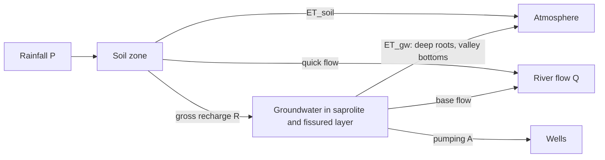

# Conceptual hydrogeological model

Both catchments lie on Precambrian crystalline basement (granites, gneisses, migmatites): the Upper Ouémé in central Benin and the Upper Ogun in the Oyo basement area of southwestern Nigeria. Studies in the Upper Ouémé describe the typical basement profile ([Kamagaté et al., 2007](https://doi.org/10.1016/j.crte.2007.04.003); [Lachassagne et al., 2021](https://link.springer.com/article/10.1007/s10040-021-02339-7)):

```
 ground surface ──────────────────────────────────────────────
   soil / laterite (rain infiltrates; most water returns as ET)
   saprolite (clay-rich weathered rock, tens of metres at most;
              stores most groundwater, low specific yield)
   fissured layer (fractured top of the bedrock; transmits water)
   fresh bedrock (little or no groundwater)
 ─────────────────────────────────────────────────────────────
```

## Water balance used in this project



Annual totals (mm/year):

- Soil zone: P = ET_soil + Q_quick + R + ΔS_soil
- Groundwater: R = Q_base + ET_gw + A + ΔS_gw
- Satellites measure P (CHIRPS, TAMSAT) and total ET = ET_soil + ET_gw (WaPOR).

What follows from this:

1. **Surplus S = P − ET** is the water left for river flow, net recharge and storage change.
2. **Closure check:** P − ET − Q = ΔS_soil + ΔS_gw, which should be close to zero over several years. With observed river flow (available for the Upper Ouémé at Bétérou), this tests whether the satellite products are consistent.
3. **Net, not gross, recharge:** because satellite ET already includes groundwater evaporation, a satellite balance can only see R − ET_gw ("net recharge"). Wells (the water-table fluctuation method) measure gross recharge R. If ET_gw is large, as is often suggested for basement catchments with deep-rooted savanna trees and wet valley bottoms, the satellite estimate will be lower than the well-based one. That difference is itself informative.
4. **Bounds without a flow split (only if the balance closes):** river flow is not split into quick flow and base flow here, so net recharge is bounded: P − ET − Q_total ≤ R − ET_gw + ΔS_soil ≤ P − ET. If the closure residual is large, the lower bound is mostly error, so these bounds are only useful once the balance closes. In the Upper Ouémé it does not (see the README), and the bounds are not reported.
5. **What a non-zero residual can contain:** over several years, P − ET − Q = ΔS_soil + ΔS_gw + groundwater leaving underground + pumping + errors in P, ET and Q. Storage can be checked against water levels: storing a residual R_cum (mm) needs a water-table rise of R_cum / (1000 × Sy) metres.

Indirect support for a significant ET_gw term in the Upper Ouémé: in the Donga sub-basin, water-table data gave recharge of 5–24% of annual rainfall while groundwater contributed little to river flow ([Kamagaté et al., 2007](https://doi.org/10.1016/j.crte.2007.04.003)). That would fit with much of the recharge leaving again through evapotranspiration rather than as base flow.

## Assumptions (stated, not tested here)

- Over a year, changes in soil water storage are small compared with the other terms.
- Groundwater does not leave the catchment underground in significant amounts (crystalline basement, shallow aquifers).
- Pumping is small compared with recharge, as reported for the Donga sub-basin of the Upper Ouémé ([Kamagaté et al., 2007](https://doi.org/10.1016/j.crte.2007.04.003)).
